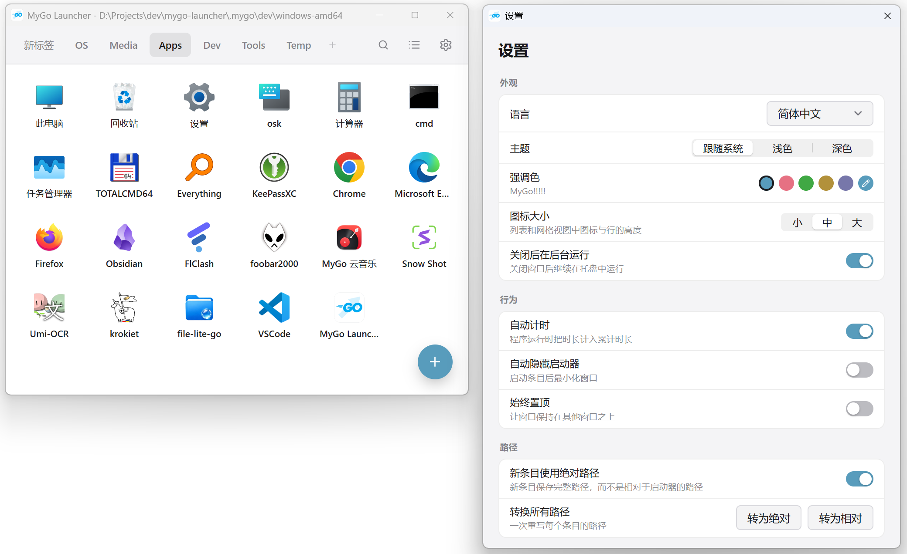

# MyGo Launcher

A portable Windows desktop launcher written in Go with the native UI of [MyGo](https://github.com/egoist/mygo) — no WebView.

[简体中文](README.md) | **English**

<p align="center">
  
</p>

## Installation

Supported today: **Windows 10/11 x64 and arm64**. 32-bit Windows and Windows 7/8 are not supported.

Download the installer or portable build for your architecture from [Releases](https://github.com/canwdev/mygo-launcher/releases/latest).

## Features

- Organize frequently used programs, files, and folders into pages; pages can be created, renamed, duplicated, removed, and reordered by dragging
- Grid layout with blank cells to control placement; icon size in three steps (small, medium, large)
- Single click on a grid item launches it; running programs can be stopped. A folder item shows its contents instead, and its folders can be entered one level at a time; panel entries open the system menu on right click
- With the timer enabled, runtime is accumulated automatically; click the duration to adjust it by ±1 hour, ±30 minutes, or minutes. When disabled, all timing stops at once, programs are no longer tracked, and the same program can run again. Folders, files, and URLs are never timed
- Items can run as administrator, prompting Windows UAC on launch
- Icons are extracted automatically for programs, files, and shortcuts; dropping in an image or `.ico` shows the image itself, and you can also pick a specific icon from an image, `.ico`, `.exe`, or `.dll`
- `.lnk` shortcuts launch with their saved target and arguments, and show the shortcut's own icon
- Drop files from Explorer to add them; drop between items to insert at that position, or onto a page chip to add them to that page
- The `+` button adds running programs, files, or hand-made items, and can also add common locations such as the Recycle Bin, This PC, Control Panel, your user folder, and the network
- Right-click menus offer Properties and the native shell menu for files and folders; the Recycle Bin can be emptied from its menu and its icon follows its state
- Items can be reordered by dragging in the grid; hovering over a page chip switches page, so you can keep dropping at the desired position (hold Ctrl/Cmd to copy)
- `Ctrl/Cmd+F` searches items, Enter launches, and the crosshair jumps to the page containing the item
- Keyboard control on the main window: arrows choose items, and continuing past the first row/item or the last row/item turns the page; Enter launches or opens a folder; PgUp/PgDn, Tab, Home/End, and 1–9 switch pages; Esc hides or minimizes; `Ctrl+,` opens settings
- Hovering an item chooses it as the keyboard would, with the same highlight, and the arrows continue from there; items get QWERTY letters by slot order with blanks included, and a letter chooses its item; icon button tooltips show their keys, e.g. "Search (Ctrl+F)" and "Settings (Ctrl+,)"
- Recordable global hotkey (function keys can be used alone) to show or hide the launcher from any window (active while the app runs); a called-for window appears centered on the pointer
- Command-line flags `--silent` (start hidden) and `--at-cursor` (show at the pointer), see below
- Closing the window keeps it running in the system tray; settings can make close quit instead
- Auto-hide, always on top, light / dark / follow system
- Settings → Appearance can replace the program icon (used by the window, tray, and About, while the settings window keeps its gear) and choose a launcher background picture (covering the whole main window, top bar included) with adjustable opacity
- The wheel switches pages by default, and Shift+wheel scrolls the grid; settings can invert this to wheel scrolls and Shift+wheel switches pages
- Window and tray icon follow the accent color and light/dark theme; the settings window icon has a gear
- Renders in memory by default to reduce memory use; GPU rendering can be enabled in settings and takes effect after restart
- Simplified Chinese and English, chosen on first launch from the Windows display language
- Import pages from `CLaunch.ini`, keeping button names, paths, arguments, and icons wherever possible

Data lives in `mygo-launcher-data/go-launcher-data.json` next to the executable; manual edits take effect immediately.

## Command line

```bash
"MyGo Launcher.exe" --silent      # start without showing the main window
"MyGo Launcher.exe" --at-cursor   # show the main window at the pointer
```

When both are passed, silent wins. If the app is already running, `--silent` leaves its windows
alone and `--at-cursor` moves the existing window to the pointer.

## Building

Requires Go 1.27+. `go.mod` uses `replace` pointing at a local `../mygo` checkout; you can remove the `replace` to use the published module instead.

```bash
go tool mygo dev     # run in dev mode, restarting on code changes
go tool mygo build   # package into build/, including the NSIS installer
go test ./...        # run tests (including headless UI tests)
```

Release, update signing, and installer details are in [docs/UPDATES.md](docs/UPDATES.md).

## Credits

- [MyGo](https://github.com/egoist/mygo): native UI and app framework
- [MyGo Music](https://github.com/egoist/mygo-cloudmusic): reference for the UI design and overall style
- [MyGO!!!!!](https://bang-dream.com/artist/mygo/): this project is not affiliated with the official group
- [CLaunch](https://ss1.xrea.com/pyonkichi.g1.xrea.com/en/): style reference

## License

[MIT](LICENSE)

Free and open source software, provided without any warranty.
