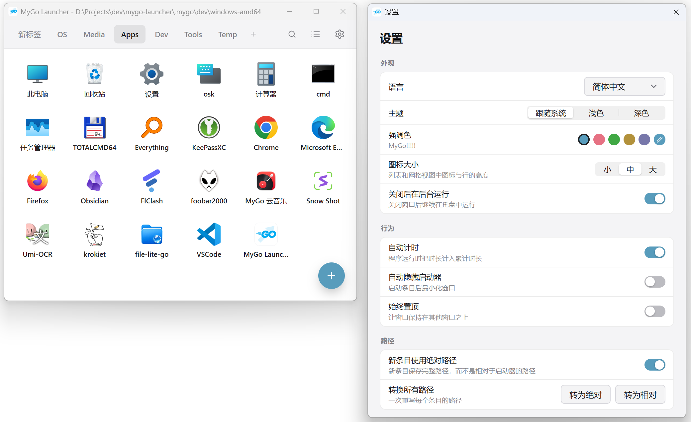

# MyGo Launcher

用 Go 和 [MyGo](https://github.com/egoist/mygo) 写的 Windows 便携式桌面启动器，原生界面，无 WebView。

**简体中文** | [English](README-en.md)

<p align="center">
  
</p>

## 安装

目前支持 **Windows 10/11 的 x64 与 arm64**；不支持 32 位 Windows 和 Windows 7/8。

从 [Releases](https://github.com/canwdev/mygo-launcher/releases/latest) 下载对应架构的安装包或便携版。

## 功能

- **页面**：用页面分组常用程序、文件和文件夹；页面可新建、重命名、复制、移除和拖动排序
- **网格**：图标分小、中、大三挡，可用「空白」格安排位置；条目名称自动换行，最多两行
- **启动**：单击启动，运行中的程序可以停止；文件夹条目单击展开内容，可逐层进入；`.lnk` 按保存的目标和参数启动，`.url` 添加时解析成里面的网址；条目可以「以管理员身份运行」，启动时弹出 Windows UAC
- **添加**：从资源管理器拖入文件即可添加；右下角 `+` 可选择运行中的窗口、文件或手动创建，也能直接加入回收站、此电脑、控制面板、用户文件夹、网络等常用位置
- **图标**：自动提取程序、文件或快捷方式的图标；拖入图片或 `.ico` 时显示图片本身，也可指定图片、`.ico`、`.exe`、`.dll` 里的某个图标，或从 Windows 的图标选择窗口里挑一个
- **整理条目**：在网格中拖动换位，拖到页面标签上稍停会切页，再继续放到想要的位置（按住 Ctrl/Cmd 为复制）
- **计时**：默认关闭；开启后自动累计运行时长，点击时长可按 ±1 小时、±30 分钟或分钟修正；关闭后立即停止计时，同一程序可以重复启动。文件夹、文件和网址不计时
- **搜索与键盘**：`Ctrl/Cmd+F` 搜索，回车启动；方向键选择条目并翻页，字母按条目在网格中的顺序选中；PgUp/PgDn、Tab、Home/End、1~9 切换页面；Esc 隐藏或最小化；`Ctrl+,` 打开设置；图标按钮的 Tooltip 会显示快捷键
- **全局快捷键**：可录制（功能键可单独使用），在任意窗口显示或隐藏启动器；唤出、再次启动或从托盘还原时，窗口出现在鼠标指针中心
- **托盘**：关闭窗口后留在系统托盘继续运行，也可改为关闭即退出；可开启「不在任务栏显示」，同时禁用最小化
- **外观**：启动条目后最小化、窗口置顶、浅色 / 深色 / 跟随系统、可自定义强调色；可更换程序图标和主界面背景图片（可调透明度），窗口与托盘图标跟随主题换色
- **滚轮**：默认切换页面，Shift+滚轮滚动网格；可在设置里改为相反
- **右键**：文件和文件夹提供「属性」与系统原生菜单；回收站可直接清空，图标随空/满更新
- **语言**：简体中文与 English，首次启动按 Windows 的显示语言选定
- **环境变量**：启动的程序使用系统当前的环境变量，启动器运行期间改过的变量立即生效
- **迁移**：从 `CLaunch.ini` 导入页面，尽量沿用按钮的名称、路径、参数和图标

便携版的数据保存在可执行文件旁的 `mygo-launcher-data/`；安装版保存在
`%LOCALAPPDATA%\MyGo Launcher\mygo-launcher-data\`，升级时旧数据会自动迁移，卸载时会询问是否
一并删除。手工修改 `go-launcher-data.json` 后会立即生效。

## 命令行

```bash
"MyGo Launcher.exe" --silent      # 启动时不显示主窗口
"MyGo Launcher.exe" --at-cursor   # 在鼠标指针处显示主窗口
```

`--silent` 与 `--at-cursor` 同时传入时以静默为准。应用已经在运行时，再次启动默认等同于
`--at-cursor`：把现有窗口移到指针中心并聚焦；带了 `--silent` 则只退出，不改变现有窗口。

## 构建

需要 Go 1.27+。`go.mod` 用 `replace` 指向本机的 `../mygo` 检出，也可以删掉 `replace` 改用发布版模块。

```bash
go tool mygo dev     # 开发模式运行，改代码自动重启
go tool mygo build   # 打包到 build/，含 NSIS 安装包
go test ./...        # 运行测试（含无头界面测试）
```

发版、更新签名与安装包细节见 [docs/UPDATES.md](docs/UPDATES.md)。

## 致谢

- [MyGo](https://github.com/egoist/mygo)：原生 UI 与应用框架
- [MyGo Music](https://github.com/egoist/mygo-cloudmusic)：界面设计与整体风格的参考
- [MyGO!!!!!](https://bang-dream.com/artist/mygo/)：本项目与官方无关
- [CLaunch](https://ss1.xrea.com/pyonkichi.g1.xrea.com/en/)：风格参考

## 许可证

[MIT](LICENSE)

开源自由软件，不做任何担保。
